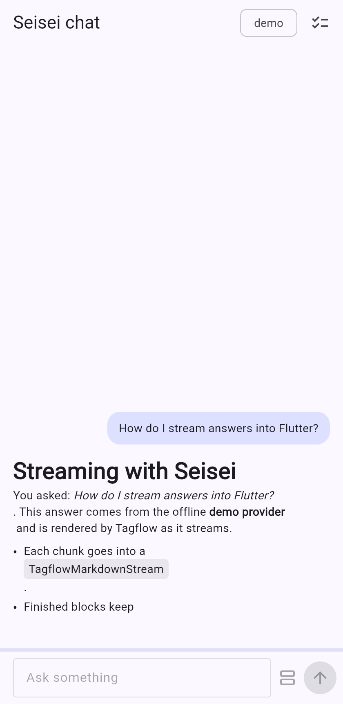
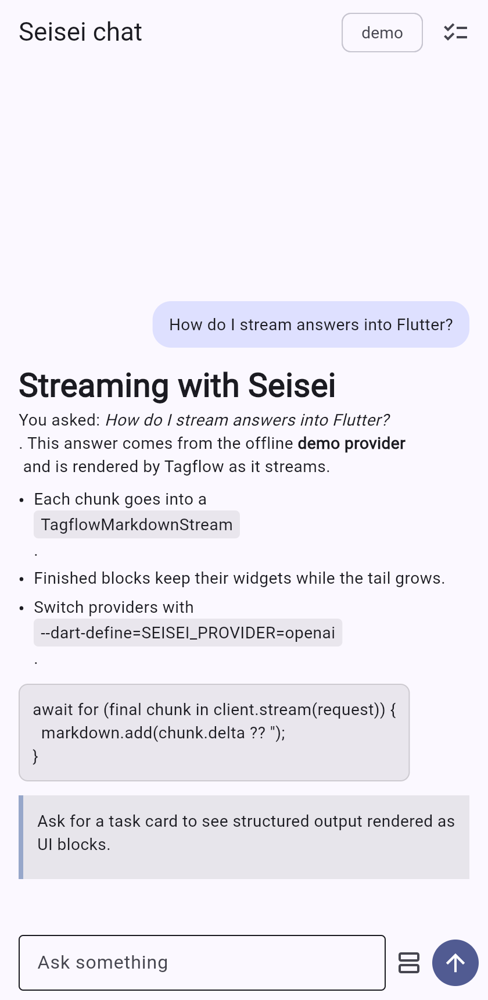
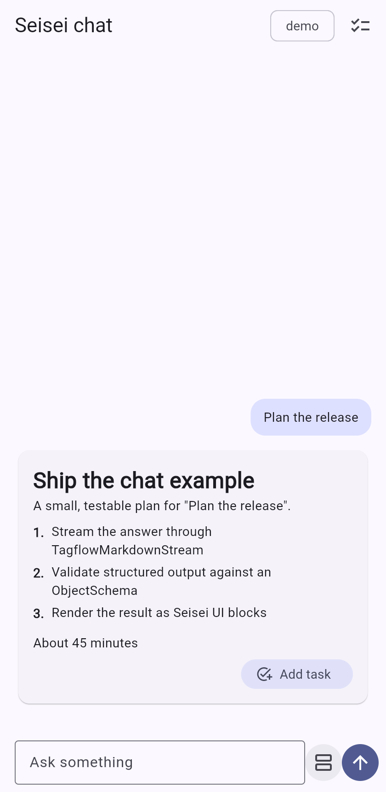

# Seisei chat example

A Flutter chat app that streams answers from a Seisei provider and renders
them with Tagflow as they arrive.

| Streaming | Finished answer | Structured card |
| --- | --- | --- |
|  |  |  |

It shows three things:

- **Streaming Markdown.** `ChatController.ask` sends a
  `GenerationRequest<String>` through `SeiseiClient.stream` and feeds every
  `chunk.delta` into a `TagflowMarkdownStream`. `TagflowMarkdownStreamView`
  renders it, and finished blocks keep their widgets while the tail grows.
- **Structured output as UI blocks.** The card button asks for a `TaskCard`
  validated by an `ObjectSchema`, converts it to `SeiseiBlock`s and renders
  them through `SeiseiTagflowAdapter`.
- **An app action.** "Add task" invokes the `add_task` `AppActionDefinition`
  through `SeiseiFlutterIntentsRuntime`. On Apple platforms the same
  definition can be turned into an App Intent with the `generate_apple_intents`
  tool from `seisei_intents`, so Siri and Shortcuts reach the same handler.

## Run

From the repository root, after `flutter pub get`:

```sh
cd examples/chat

# Offline demo provider (default, no keys needed)
flutter run

# Any OpenAI-compatible server
flutter run \
  --dart-define=SEISEI_PROVIDER=openai \
  --dart-define=OPENAI_MODEL=gpt-4o-mini \
  --dart-define=OPENAI_API_KEY=sk-...

# Ollama or LM Studio
flutter run \
  --dart-define=SEISEI_PROVIDER=openai \
  --dart-define=OPENAI_BASE_URL=http://localhost:11434/v1 \
  --dart-define=OPENAI_MODEL=llama3.2

# Apple Foundation Models on a supported iOS or macOS device
flutter run --dart-define=SEISEI_PROVIDER=apple
```

The app ships iOS, Android, macOS and web runners. The Apple provider and the
App Intent bridge need an Apple platform; the demo and OpenAI-compatible
providers run everywhere.

## Test

```sh
flutter test
```

The widget tests use the demo provider and run in CI through
`dart tool/validate.dart`.

## Tagflow version

`TagflowMarkdownStream` is on Tagflow `main` but not yet on pub.dev, so the
workspace root `pubspec.yaml` overrides `tagflow` with a pinned git
dependency. Drop the override once a Tagflow release includes it.
